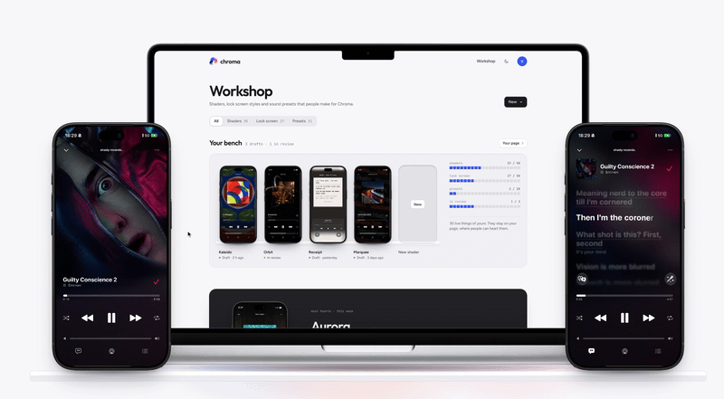

<div align="center">

# Spotify Enhanced

**A podcast enhancement add-on for Taurus, the open-sourced Spotify tweak (v0.60.5)**

Fresh starts, blocked sections, per-episode authors, song-style rows and podcast listening stats.



[](https://github.com/samj-exe/taurus/releases)
[](https://github.com/samj-exe/taurus/releases)
[](https://github.com/samj-exe/taurus)
[](https://github.com/samj-exe/taurus/stargazers)
[](https://github.com/samj-exe/taurus/releases)

</div>

---

## What is Spotify Enhanced?

Spotify Enhanced adds quality-of-life improvements for **podcasts** to **Taurus** while keeping the rest of the tweak intact. Everything lives on one new page, **Mod Settings → Podcasts**.

The project is an add-on for [Taurus](https://github.com/samj-exe/taurus), which is an open-sourced fork of chroma.pw with built-in Spotify Premium. It is distributed as a zip with the new and changed source files, plus one patch made against Taurus v0.60.5.

> [!IMPORTANT]
> This is not an IPA or a `.deb` on its own. You add it to the Taurus source and build Taurus again. No Spotify files are included, you still need your own decrypted Spotify IPA as described in the Taurus README.

## What this adds

- **Always start at 0:00.** A podcast episode begins at the start, not where you left off.
- **Restart when you press play.** After a pause, pressing play sends the episode back to 0:00.
- **Blocked sections.** Skip time ranges of an episode, for example an ad or an intro. They are skipped in playlists too. A range can run to the end of the episode, and then playback moves on to the next one.
- **Podcast listening stats.** Podcast minutes count in Listening stats, next to songs.
- **Song-style rows.** Podcast episodes on a show page, a playlist and Your Library can be drawn as song rows, with the podcast's author under the title.
- **Author per episode.** Replace the author name shown under any episode with your own.
- **Skip like songs.** Next and previous in the player and on the lock screen, in place of the ±15 seconds buttons. On by default.

### Settings

| Setting | What it does | Default |
|---|---|---|
| Always start at 0:00 | An episode begins at the start | Off |
| Restart when you press play | Pause, then play: back to 0:00 | Off |
| Skip blocked sections | Jump over the parts you blocked | Turns on when you block your first section |
| Blocked sections | The list of ranges, tap to change, swipe to remove | Empty |
| Episodes look like songs | Song-style rows for episodes (Redesigned look only) | Off |
| Author per episode | Names that replace an episode's author | Empty |
| Skip like songs | Next and previous in place of ±15 seconds | On |

### Blocking a section

Play the episode, then open **Mod Settings → Podcasts → Blocked sections → Block part of what's playing**. Times look like `2:10` or `1:02:10`. Leave the end empty to block to the end of the episode.

Block `2:10 – 14:00` and the episode plays from 0:00 to 2:10, then carries on at 14:00. Sections that overlap or touch are chained into one.

## What is not included

- Changes to the music side of Taurus, this add-on only touches podcasts
- Changes to Spotify's own downloads, lyrics or Live Activity
- Any Spotify app files, IPAs or signing certificates
- Support for other Taurus versions, see [Supported versions](#supported-versions)

## Supported versions

| Project | Version | Supported |
|---|---|---|
| Taurus | v0.60.5 | Yes |
| Taurus | Other versions | Not tested, copy the files by hand |
| Redesigned UI (song-style rows) | iOS 26+ | Yes |
| Everything else | Same as Taurus | Yes |

Song-style rows only exist in the Redesigned look, which needs iOS 26 or newer. The other podcast settings work in either look.

## How to add it

1. Download `Podcast-Addon.zip` from the [Releases](https://github.com/samj-exe/taurus/releases) page and unzip it.
2. Add it to your copy of the Taurus repo with one of the two options below.
3. Build Taurus as usual, see [Building](#building).

**Option A: copy**

Copy the `tweak/` and `docs/` folders from the zip over the repo and accept the replacements.

**Option B: patch**

From the root of the Taurus repo:

```
git apply podcasts.patch
```

The patch was made against Taurus v0.60.5. If it does not apply, use option A.

### What changes

New files:

- `tweak/Sources/Shared/Podcasts/` (5 files: `PodcastBlocks.m`, `PodcastPlayback.x`, `Podcasts.h`, `PodcastSkips.x`, `PodcastsSettings.m`)
- `tweak/Sources/Redesigned/Album/PodcastRows.x`

Changed files:

- `tweak/Sources/App/ModSettings.x`
- `tweak/Sources/Redesigned/Album/AlbumHeader.x`
- `tweak/Sources/Shared/ListeningStats/ListeningStats.h`
- `tweak/Sources/Shared/ListeningStats/ListeningStats.x`
- `docs/tweaks.md`

## Building

You only need this to get the add-on into an IPA. The Taurus Makefile picks up the new files by itself.

**With GitHub Actions (recommended):** push the changed files to your fork of Taurus, enable Actions and run **Build IPA from your own Spotify IPA** with a direct link to your decrypted Spotify 9.1.90 IPA.

**On a Mac:** Theos in `~/theos` and Xcode with an iPhoneOS 26+ SDK, then put the decrypted `.ipa` in `ipa/` and run:

```
make release
```

The unsigned `Taurus-<version>.ipa` ends up in `out/`. Sign it with SideStore, Feather or any certificate signer. See the [Taurus README](https://github.com/samj-exe/taurus) for the full setup.

## How it works

The file `PodcastPlayback.x` watches the episode playing, and a 0.15 s timer runs only while an episode with blocked sections plays, or while a new episode's first position is awaited. Blocked sections are stored per episode URI as start and end seconds, and `PodcastBlocks.m` finds where playback has to go. Nothing leaves the phone. More detail is in `docs/tweaks.md`.

## Versions

Each release is tagged with the project name and a version number. `Spotify Enhanced` is the first release, later updates use `SE-v1.1`, `SE-v1.2` and so on.

<!--
## What does it look like?
Add screenshots here once you have them, for example:


-->

## Known issues

This is a pre-release and has not been fully playtested. It is made against Taurus v0.60.5 and not tested on other versions. If you find a bug, please open an issue and include the Taurus and Spotify versions, the steps to reproduce it and, if possible, a screenshot.

## Credits

- [Taurus](https://github.com/samj-exe/taurus) by samj-exe
- chroma.pw/spoti.pw by darkk, which Taurus is a fork of

## Disclaimer

This is a fan project. It is not affiliated with, endorsed by or sponsored by Spotify. Spotify and all related names are trademarks of their respective owners. This repository contains no Spotify app files, only source code for the add-on.
